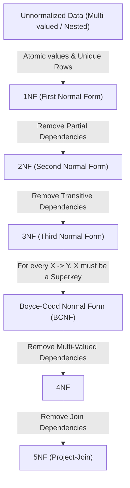

# Database Management Systems (DBMS): Normalization

Comprehensive master guide to **Database Normalization**, Functional Dependencies, Normal Forms (1NF through 5NF/BCNF), Decomposition Properties, and Real-World Tradeoffs.

---

## 1. What is Normalization?

**Normalization** is a systematic database design technique used to organize tables and their columns in a relational database management system (RDBMS) to:

1. **Minimize data redundancy** (unnecessary duplication of data).
2. **Eliminate data modification anomalies** (insertion, update, and deletion issues).
3. **Maintain data integrity and consistency** through well-defined functional dependencies and foreign key constraints.

---

## 2. Database Anomalies (Why We Need Normalization)

Consider an unnormalized table storing tournament participants, teams, and tournament details in a single flat table:

### Unnormalized Relation: `Tournament_Roster`

| player_id | player_name | team_id | team_name | tournament_id | tournament_name | prize_pool |
|:---|:---|:---|:---|:---|:---|:---|
| P101 | Viper | T1 | Soul Esports | TOUR_01 | BMPS 2026 | \$50,000 |
| P102 | Goblin | T1 | Soul Esports | TOUR_01 | BMPS 2026 | \$50,000 |
| P103 | Hector | T1 | Soul Esports | TOUR_01 | BMPS 2026 | \$50,000 |
| P201 | Scout | T2 | Team X | TOUR_02 | VCT Pacific | \$100,000 |

### 1. Insertion Anomaly
- **Problem:** You cannot insert information about a newly formed team or a newly announced tournament unless at least one player is already registered.
- **Example:** If `player_id` is part of the primary key, we cannot insert `TOUR_03` ("Masters Tokyo") because `player_id` cannot be `NULL`.

### 2. Update (Modification) Anomaly
- **Problem:** If a data value changes, it must be updated in multiple independent rows. If any row is missed, the database enters an inconsistent state.
- **Example:** If `Soul Esports` rebrands to `S8UL Gaming`, we must update all rows where `team_id = 'T1'`. If only two of three rows are updated, the database contains contradictory data.

### 3. Deletion Anomaly
- **Problem:** Deleting one piece of information unintentionally deletes unrelated critical information.
- **Example:** If player `P201` ("Scout") leaves or is deleted, the entire record for `TOUR_02` ("VCT Pacific", prize pool \$100,000) is permanently lost from the database.

---

## 3. Functional Dependencies (FDs)

A **Functional Dependency** is a relationship between attributes in a relation. 

Given a relation $R$, an attribute set $Y$ is functionally dependent on $X$ (denoted as $X \to Y$, read *"X determines Y"* or *"Y is functionally dependent on X"*), if and only if:

$$\forall t_1, t_2 \in R, \quad \text{if } t_1[X] = t_2[X] \implies t_1[Y] = t_2[Y]$$

In words: Whenever two tuples agree on attribute set $X$, they must also agree on attribute set $Y$.

### Types of Functional Dependencies

| Type | Definition | Example |
|:---|:---|:---|
| **Trivial FD** | $X \to Y$ where $Y \subseteq X$ (the right-hand side is a subset of the left-hand side). | `(player_id, player_name) -> player_id` |
| **Non-Trivial FD** | $X \to Y$ where $Y \not\subseteq X$. Completely non-trivial if $X \cap Y = \emptyset$. | `player_id -> email` |
| **Full Functional Dependency** | $X \to Y$ where removal of any attribute from $X$ breaks the dependency (no proper subset of $X$ determines $Y$). | `(tournament_id, team_id) -> slot_number` |
| **Partial Dependency** | $X \to Y$ where $X$ is composite, and an attribute in $Y$ is determined by a **proper subset** of $X$. | `(player_id, team_id) -> player_name` (since `player_id -> player_name`) |
| **Transitive Dependency** | $X \to Z$ via an intermediate non-key attribute $Y$ ($X \to Y$ and $Y \to Z$, where $Y \not\to X$). | `player_id -> team_id` and `team_id -> org_name` |

---

## 4. Keys in Relational Databases

- **Super Key (SK):** A set of attributes that uniquely identifies every tuple in a relation.
- **Candidate Key (CK):** A **minimal** Super Key (no proper subset is a superkey).
- **Primary Key (PK):** A candidate key chosen by the database architect as the primary identifier.
- **Prime Attribute:** An attribute that is part of **any** candidate key.
- **Non-Prime Attribute:** An attribute that is **not** part of any candidate key.

---

## 5. Armstrong's Axioms & Attribute Closure

### Armstrong's Axioms (Inference Rules)
Given functional dependencies $F$, the following rules are sound and complete:

1. **Reflexivity:** If $Y \subseteq X$, then $X \to Y$.
2. **Augmentation:** If $X \to Y$, then $XZ \to YZ$.
3. **Transitivity:** If $X \to Y$ and $Y \to Z$, then $X \to Z$.

**Derived Secondary Rules:**
- **Union:** If $X \to Y$ and $X \to Z$, then $X \to YZ$.
- **Decomposition:** If $X \to YZ$, then $X \to Y$ and $X \to Z$.
- **Pseudo-Transitivity:** If $X \to Y$ and $WY \to Z$, then $WX \to Z$.

### Attribute Closure Algorithm ($X^+$)
The closure $X^+$ with respect to a set of FDs $F$ is the set of all attributes functionally determined by $X$.

**Algorithm:**
1. Initialize $X^{(0)} = X$.
2. Repeat:
   $$X^{(i+1)} = X^{(i)} \cup \{ B \mid \exists (A \to B) \in F \text{ such that } A \subseteq X^{(i)} \}$$
3. Stop when $X^{(i+1)} = X^{(i)}$.
4. Return $X^+ = X^{(i)}$.

> **Usage:** If $X^+$ contains all attributes of relation $R$, then $X$ is a **Super Key**. If no proper subset of $X$ determines all attributes, $X$ is a **Candidate Key**.

---

## 6. Normal Forms (1NF through BCNF)



---

### First Normal Form (1NF)

#### Definition
A relation $R$ is in **1NF** if:
1. Every attribute value is **atomic** (indivisible). No arrays, comma-separated lists, or nested relations.
2. Each column has a unique name.
3. Order of rows and columns does not matter.
4. Each row is unique (table has a primary key).

#### Non-1NF Violation Example:
```text
Player(id, name, games_played)
P101 | Viper | "VALORANT, BGMI, Free Fire"   <-- Non-atomic list!
```

#### Resolution to 1NF:
Decompose into atomic rows:
```text
Player_Games(player_id, player_name, game)
P101 | Viper | VALORANT
P101 | Viper | BGMI
P101 | Viper | Free Fire
```

---

### Second Normal Form (2NF)

#### Definition
A relation $R$ is in **2NF** if:
1. It is in **1NF**.
2. **No non-prime attribute is partially dependent on any candidate key.** (Every non-prime attribute must be *fully functionally dependent* on the entire candidate key).

> [!NOTE]
> If a table's candidate key consists of a **single attribute**, it is automatically in 2NF once it satisfies 1NF, because partial dependencies are impossible with single-attribute keys.

#### 2NF Violation Example:
Consider relation $R(player\_id, tournament\_id, player\_name, tournament\_name, score)$:
- Candidate Key: `(player_id, tournament_id)`
- Functional Dependencies:
  - `(player_id, tournament_id) -> score` (Full Dependency)
  - `player_id -> player_name` (**Partial Dependency!** `player_name` depends only on `player_id`)
  - `tournament_id -> tournament_name` (**Partial Dependency!** `tournament_name` depends only on `tournament_id`)

#### Resolution to 2NF:
Decompose into 3 tables:
1. `Player(player_id, player_name)` — PK: `player_id`
2. `Tournament(tournament_id, tournament_name)` — PK: `tournament_id`
3. `Tournament_Score(player_id, tournament_id, score)` — PK: `(player_id, tournament_id)`

---

### Third Normal Form (3NF)

#### Definition
A relation $R$ is in **3NF** if:
1. It is in **2NF**.
2. There are **no transitive dependencies** for non-prime attributes.

**Formal Condition:**  
For every non-trivial functional dependency $X \to Y$:
- **Either** $X$ is a **Super Key**,
- **Or** $Y$ is a **Prime Attribute** (part of some candidate key).

#### 3NF Violation Example:
Consider relation $R(player\_id, player\_name, team\_id, team\_name, org\_email)$:
- Candidate Key: `player_id`
- Functional Dependencies:
  - `player_id -> team_id` ($X \to Y$, where `player_id` is a Super Key)
  - `team_id -> team_name, org_email` ($Y \to Z$, where `team_id` is NOT a Super Key and `team_name` is non-prime)
  - Therefore: `player_id -> team_name` is a **transitive dependency**.

#### Resolution to 3NF:
Decompose into:
1. `Player(player_id, player_name, team_id)` — PK: `player_id`, FK: `team_id`
2. `Team(team_id, team_name, org_email)` — PK: `team_id`

---

### Boyce-Codd Normal Form (BCNF / 3.5NF)

#### Definition
A relation $R$ is in **BCNF** if:
For **every** non-trivial functional dependency $X \to Y$, **$X$ MUST be a Super Key**.

#### 3NF vs BCNF Difference:
- In 3NF, $X \to Y$ is allowed if $Y$ is a prime attribute even if $X$ is not a superkey.
- In BCNF, this exception is eliminated. **$X$ must always be a superkey.**

#### BCNF Violation Example:
Relation `Team_Coach_Game(team, game, coach)`
- Business Rules:
  1. Each coach teaches only one game: `coach -> game`
  2. For a specific game, a team has one coach: `(team, game) -> coach`
- Candidate Keys:
  - `(team, game)`
  - `(team, coach)`
- Prime Attributes: `team`, `game`, `coach`
- Check 3NF:
  - For `coach -> game`: `coach` is NOT a superkey, but `game` IS a prime attribute. Thus, the table is in **3NF**.
- Check BCNF:
  - In `coach -> game`, `coach` is NOT a superkey. Hence, it **violates BCNF**.

#### Resolution to BCNF:
Decompose into:
1. `Coach_Assignment(coach, game)` — PK: `coach` ($coach \to game$)
2. `Team_Coach(team, coach)` — PK: `(team, coach)`

---

## 7. Higher Normal Forms Overview

| Normal Form | Condition / Target |
|:---|:---|
| **4NF (Fourth Normal Form)** | Eliminates **Multi-Valued Dependencies (MVDs)** ($X \twoheadrightarrow Y$). A relation is in 4NF if for every non-trivial MVD $X \twoheadrightarrow Y$, $X$ is a superkey. |
| **5NF (Project-Join NF)** | Eliminates **Join Dependencies (JDs)**. Relation cannot be non-loss decomposed into smaller tables without join dependencies. |
| **DKNF (Domain-Key NF)** | Theoretical ultimate NF: every constraint is a logical consequence of domain constraints and key constraints. |

---

## 8. Decomposition Properties

When decomposing a relation $R$ into $R_1, R_2, \dots, R_k$, the decomposition must satisfy two foundational properties:

### 1. Lossless-Join Decomposition (Mandatory)
A decomposition of $R$ into $R_1$ and $R_2$ is **lossless** if and only if the natural join recovers the exact original relation without spurious tuples:

$$R_1 \bowtie R_2 = R$$

**Theorem:**  
A decomposition of $R$ into $(R_1, R_2)$ is lossless with respect to a set of FDs $F$ if and only if their common attribute set forms a superkey in at least one of the relations:

$$(R_1 \cap R_2) \to R_1 \quad \text{OR} \quad (R_1 \cap R_2) \to R_2$$

### 2. Dependency Preservation (Desirable)
A decomposition is **dependency preserving** if the union of functional dependencies enforceable on individual sub-relations covers all original dependencies:

$$(F_1 \cup F_2 \cup \dots \cup F_k)^+ = F^+$$

> [!TIP]
> - **3NF** can **always** guarantee both Lossless Join AND Dependency Preservation.
> - **BCNF** guarantees Lossless Join and eliminates all redundancy based on FDs, but **may not preserve all dependencies**.

---

## 9. Quick Normal Form Decision Matrix

| Normal Form | Eliminates | Requirement for $X \to Y$ | Always Preserves Dependencies? |
|:---|:---|:---|:---:|
| **1NF** | Non-atomic attributes & duplicate rows | Values must be atomic; Primary key exists | Yes |
| **2NF** | Partial dependencies | Non-prime attributes depend on full candidate key | Yes |
| **3NF** | Transitive dependencies | $X$ is Super Key **OR** $Y$ is Prime Attribute | **Yes** |
| **BCNF** | All functional dependency redundancies | $X$ is **strictly** a Super Key | No (can lose FDs) |
| **4NF** | Multi-valued dependencies ($X \twoheadrightarrow Y$) | $X$ is Super Key for all non-trivial MVDs | No |

---

## 10. Real-World Case Study: Normalization in FLUX Esports Platform

Consider how FLUX's PostgreSQL schema implements 3NF / BCNF:

```sql
-- 1. Organizations (BCNF: id is Super Key)
CREATE TABLE IF NOT EXISTS "org" (
  id UUID PRIMARY KEY DEFAULT gen_random_uuid(),
  name VARCHAR(100) NOT NULL UNIQUE,
  email VARCHAR(255) NOT NULL UNIQUE
);

-- 2. Teams (Foreign Key to Org; 3NF: No transitive org info stored here)
CREATE TABLE IF NOT EXISTS "team" (
  id UUID PRIMARY KEY DEFAULT gen_random_uuid(),
  org_id UUID REFERENCES "org"(id) ON DELETE SET NULL,
  captain_id UUID REFERENCES "player"(id) ON DELETE SET NULL,
  name VARCHAR(100) NOT NULL,
  game VARCHAR(50) NOT NULL
);

-- 3. Team Roster Members (Avoids multi-valued player arrays in team table)
CREATE TABLE IF NOT EXISTS "team_member" (
  id UUID PRIMARY KEY DEFAULT gen_random_uuid(),
  team_id UUID NOT NULL REFERENCES "team"(id) ON DELETE CASCADE,
  player_id UUID REFERENCES "player"(id) ON DELETE SET NULL,
  role VARCHAR(50) NOT NULL DEFAULT 'Member'
);
```

### When to Intentionally Denormalize?
1. **High-traffic Read Paths:** Caching summary counters (e.g. `likes_count INT DEFAULT 0` on posts or `slots_count` on teams) avoids expensive `COUNT(*)` aggregations on every page render.
2. **Audit Trails & Invoices:** Storing historical snapshots (e.g., ticket price at the exact moment of tournament registration) so future price modifications do not alter historical records.
3. **Analytical OLAP Queries:** Data warehousing tables formatted as Star Schemas or Snowflake Schemas optimized for columnar OLAP engines.
