# Database Management Systems (DBMS): Entity-Relationship (ER) Architecture

Comprehensive architectural specification, relational entity-relationship diagrams, cardinality rules, and relational schemas for the **FLUX Competitive Gaming Platform**.

---

## 1. Visual ER Diagram (Mermaid)

```mermaid
erDiagram
    ADMIN ||--o{ ORG_VERIFICATION : reviews
    ADMIN ||--o{ ORGANIZER_VERIFICATION : reviews

    ORG ||--o{ TEAM : owns
    ORG ||--o{ POST : publishes
    ORG ||--o{ ORG_VERIFICATION : submits

    TOURNAMENT_ORGANIZER ||--o{ TOURNAMENT : organizes
    TOURNAMENT_ORGANIZER ||--o{ SCRIM : hosts
    TOURNAMENT_ORGANIZER ||--o{ ORGANIZER_VERIFICATION : submits

    PLAYER ||--o| TEAM : captains
    PLAYER ||--o{ TEAM_MEMBER : occupies_slot
    PLAYER ||--o{ TEAM_INVITATION : receives
    PLAYER ||--o{ APPLICATION : submits
    PLAYER ||--o{ POST_LIKE : likes
    PLAYER ||--o{ POST_COMMENT : writes
    PLAYER ||--o{ MESSAGE : sends_or_receives
    PLAYER ||--o{ PLAYER_CONNECTION : networks_with

    TEAM ||--|{ TEAM_MEMBER : has_roster
    TEAM ||--o{ TEAM_INVITATION : issues
    TEAM ||--o{ ROLE_POSTING : publishes
    TEAM ||--o{ REGISTRATION : registers_for
    TEAM ||--o{ SCRIM_REGISTRATION : registers_for
    TEAM ||--o{ TEAM_MESSAGE : broadcasts_comms

    ROLE_POSTING ||--o{ APPLICATION : receives

    TOURNAMENT ||--o{ REGISTRATION : contains

    SCRIM ||--o{ SCRIM_REGISTRATION : contains

    POST ||--o{ POST_LIKE : receives_likes
    POST ||--o{ POST_COMMENT : has_comments

    PLAYER {
        uuid id PK
        varchar username UK
        varchar email UK
        text password_hash
        varchar google_id UK
        varchar game_ign
        varchar tagline
        text bio
        text avatar_url
        varchar primary_game
        uuid team_id FK
        uuid org_id FK
        timestamptz created_at
    }

    ORG {
        uuid id PK
        varchar name UK
        varchar email UK
        text password_hash
        boolean verified
        timestamptz created_at
    }

    TOURNAMENT_ORGANIZER {
        uuid id PK
        varchar name
        varchar email UK
        text password_hash
        boolean verified
        timestamptz created_at
    }

    ADMIN {
        uuid id PK
        varchar email UK
        text password_hash
        timestamptz created_at
    }

    TEAM {
        uuid id PK
        uuid org_id FK
        uuid captain_id FK
        varchar name
        varchar game
        varchar tag
        varchar division
        varchar status
        int slots_max
        timestamptz created_at
    }

    TEAM_MEMBER {
        uuid id PK
        uuid team_id FK
        uuid player_id FK
        varchar name
        varchar ign
        varchar role
        boolean is_captain
        timestamptz created_at
    }

    TEAM_INVITATION {
        uuid id PK
        uuid team_id FK
        uuid player_id FK
        uuid invited_by FK
        varchar role
        varchar status
        timestamptz created_at
    }

    ROLE_POSTING {
        uuid id PK
        uuid team_id FK
        varchar role
        text description
        varchar status
        timestamptz created_at
    }

    APPLICATION {
        uuid id PK
        uuid player_id FK
        uuid posting_id FK
        text pitch
        text vod_link
        varchar status
        timestamptz created_at
    }

    TOURNAMENT {
        uuid id PK
        uuid organizer_id FK
        varchar name
        varchar game
        varchar status
        timestamptz start_date
        timestamptz created_at
    }

    REGISTRATION {
        uuid id PK
        uuid tournament_id FK
        uuid team_id FK
        varchar status
        timestamptz registered_at
    }

    SCRIM {
        uuid id PK
        uuid organizer_id FK
        varchar name
        varchar game
        varchar status
        int slots_max
        varchar room_id
        varchar room_password
        timestamptz scheduled_at
        timestamptz created_at
    }

    SCRIM_REGISTRATION {
        uuid id PK
        uuid scrim_id FK
        uuid team_id FK
        varchar check_in_status
        timestamptz created_at
    }

    POST {
        uuid id PK
        varchar author_type
        uuid author_id
        varchar category
        varchar game
        int likes_count
        text content
        timestamptz created_at
    }

    POST_LIKE {
        uuid id PK
        uuid post_id FK
        uuid user_id
        timestamptz created_at
    }

    POST_COMMENT {
        uuid id PK
        uuid post_id FK
        uuid author_id
        varchar author_name
        text content
        timestamptz created_at
    }

    MESSAGE {
        uuid id PK
        uuid sender_id FK
        uuid receiver_id FK
        text content
        boolean read
        timestamptz created_at
    }

    TEAM_MESSAGE {
        uuid id PK
        uuid team_id FK
        uuid sender_id
        varchar sender_role
        varchar sender_name
        text content
        timestamptz created_at
    }

    PLAYER_CONNECTION {
        uuid id PK
        uuid requester_id FK
        uuid receiver_id FK
        varchar status
        timestamptz created_at
    }

    ORG_VERIFICATION {
        uuid id PK
        uuid org_id FK
        varchar legal_name
        varchar status
        uuid reviewed_by FK
        timestamptz created_at
    }

    ORGANIZER_VERIFICATION {
        uuid id PK
        uuid organizer_id FK
        varchar org_name
        varchar status
        uuid reviewed_by FK
        timestamptz created_at
    }
```

---

## 2. Core Entities & Attribute Catalog

### 1. Account & Identity Entities
- **`PLAYER`**: Represents competitive gaming athletes. Contains user credentials (with optional `google_id` for OAuth 2.0), competitive gaming passports (tagline, bio, primary game, game IGN), and optional direct links to team or organization.
- **`ORG`**: Professional esports organizations (e.g. S8UL, Global Esports). Owns and finances competitive rosters.
- **`TOURNAMENT_ORGANIZER`**: Third-party tournament host entities (e.g. Skyesports, NODWIN). Hosts scrims and tournaments upon admin verification.
- **`ADMIN`**: Platform operators responsible for compliance, verification review, and platform governance.

### 2. Squad & Roster Entities
- **`TEAM`**: Competitive squads formed under a specific title (VALORANT, BGMI, etc.). Owned either by an `ORG` or captained by a `PLAYER`.
- **`TEAM_MEMBER`**: Individual starting roster slots (1 to 5 players) tracking IGN, tactical role, and captaincy.
- **`TEAM_INVITATION`**: Direct roster invites issued by team captains to registered platform athletes.

### 3. Recruitment & Tryout Entities
- **`ROLE_POSTING`**: Open tryout notices published by team captains (e.g. "Looking for IGL / Entry Fragger").
- **`APPLICATION`**: Athlete tryout submissions containing written cover pitch, VOD review URL, and application status.

### 4. Tournament & Scrim Competition Entities
- **`TOURNAMENT`**: Official esports events with scheduled dates and statuses (`upcoming`, `ongoing`, `completed`).
- **`REGISTRATION`**: Team registrations for tournaments.
- **`SCRIM`**: Practice scrim lobbies created by verified organizers featuring private room IDs and credentials.
- **`SCRIM_REGISTRATION`**: Team check-in and reservation slots for scrim matches.

### 5. Communication & Community Entities
- **`MESSAGE`**: 1-to-1 encrypted private direct messages between individual athletes.
- **`TEAM_MESSAGE`**: Real-time squad tactical comms exclusive to roster members, captains, and owners.
- **`POST`**, **`POST_LIKE`**, **`POST_COMMENT`**: Community feeds, media highlights, and social interactions.
- **`PLAYER_CONNECTION`**: Bidirectional athlete-to-athlete professional networking connections.

---

## 3. Relationship Cardinalities & Integrity Constraints

| Relationship | Entities | Cardinality | Business Rule & Referential Integrity |
|:---|:---|:---:|:---|
| **Org Ownership** | `ORG` $\to$ `TEAM` | `1 : N` | An org can sponsor multiple teams. If an org is deleted, `team.org_id` sets to `NULL` (preserving roster). |
| **Team Captaincy** | `PLAYER` $\to$ `TEAM` | `1 : N` | A player can captain a team. Deleting player sets `team.captain_id` to `NULL`. |
| **Roster Slotting** | `TEAM` $\to$ `TEAM_MEMBER` | `1 : N` | A team consists of up to `slots_max` members. Deleting a team cascades and deletes roster slots. |
| **Athlete Exclusivity** | `PLAYER` $\to$ `(TEAM, ORG)` | Constraint | `CHECK (team_id IS NULL OR org_id IS NULL)` ensures dual affiliation integrity. |
| **Tryout Applications** | `PLAYER` $\times$ `ROLE_POSTING` $\to$ `APPLICATION` | `N : M` | Unique constraint `UNIQUE(player_id, posting_id)` prevents duplicate applications. |
| **Tournament Reg** | `TEAM` $\times$ `TOURNAMENT` $\to$ `REGISTRATION` | `N : M` | Unique constraint `UNIQUE(tournament_id, team_id)`. |
| **Direct Messaging** | `PLAYER` $\times$ `PLAYER` $\to$ `MESSAGE` | `1 : N` | `sender_id` and `receiver_id` both reference `player(id)` on delete cascade. |
| **Squad Comms** | `TEAM` $\to$ `TEAM_MESSAGE` | `1 : N` | Messages cascade-delete when team is removed. |
| **Admin Review** | `ADMIN` $\to$ `(ORG_VERIF, ORGANIZER_VERIF)` | `1 : N` | Deleting an admin sets `reviewed_by` to `NULL` to retain historical audit logs. |

---

## 4. Normalization Audit
- Every entity table has a single UUID surrogate primary key (BCNF).
- Multi-valued attributes (e.g. roster members, applications, scrimmage teams) are partitioned into dedicated junction and child relations (1NF, 2NF).
- Non-prime attributes are strictly determined solely by their respective primary keys without transitive dependencies (3NF).
